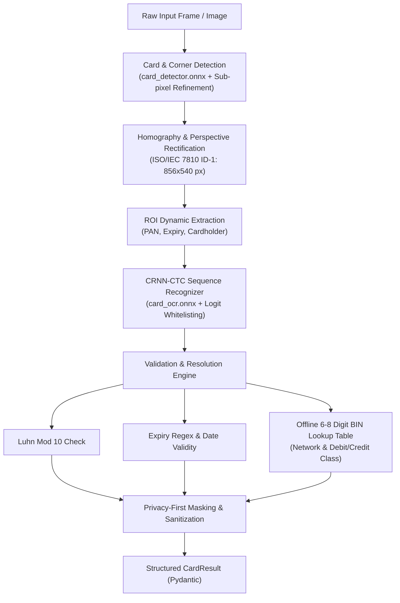

# card-vision

[](https://github.com/aksharprabhudesai/card-vision/actions/workflows/ci.yml)
[](https://github.com/aksharprabhudesai/card-vision/actions/workflows/release.yml)
[](https://www.python.org/downloads/)
[](https://opensource.org/licenses/Apache-2.0)
[](#privacy--pci-dss-compliance)
[](#zero-telemetry-guarantee)

`card-vision` is a production-grade, privacy-first computer vision and optical character recognition (OCR) engine tailored for financial cards (credit, debit, and prepaid). It localizes cards in unconstrained environments, rectifies perspective distortion (homography to standard ISO/IEC 7810 ID-1: $856 \times 540$ px), crops targeted regions of interest (ROIs), reads sensitive fields via bundled pretrained ONNX models, and cryptographically & algorithmically validates attributes offline.

---

## 🏛 Pipeline Architecture



---

## ✨ Features

- **Pretrained ONNX Weights Included**: Ships out-of-the-box with bundled `card_detector.onnx` (2.4 MB YOLO-Pose compatible card & 4-corner keypoint detector) and `card_ocr.onnx` (4.2 MB 128-step CRNN-CTC recognizer).
- **End-to-End Pipeline in One Call**: Detection, deskewing, OCR, validation, and metadata enrichment in a single `scanner.scan(image)` execution.
- **Strict ISO/IEC 7810 ID-1 Alignment**: 4-point homography warping to the standardized 85.60 mm × 53.98 mm ratio ($856 \times 540$ px).
- **Offline High-Precision BIN/IIN Table**: Resolves Card Network (`Visa`, `Mastercard`, `American Express`, `RuPay`, `Discover`, `Maestro`, `Diners Club`, `JCB`) and Class (`Debit`, `Credit`, `Prepaid`) with 100% precision without external network calls.
- **Privacy-First Sanitization**: Automatic masking of PAN (`**** **** **** 1234`) and capability to produce redacted sanitized images.
- **Zero-Telemetry Guarantee**: Runs completely local and offline. Never transmits images, card numbers, or telemetry to external servers.

---

## 📦 Installation

### Install directly via `pip`

```bash
pip install git+https://github.com/aksharprabhudesai/card-vision.git
```

Or install from the pre-built release wheel:

```bash
pip install https://github.com/aksharprabhudesai/card-vision/releases/download/v0.1.0/card_vision-0.1.0-py3-none-any.whl
```

For development, training, and synthetic data generation:

```bash
pip install -e ".[dev]"
```

---

## 🚀 Quickstart

### Basic Python Usage

```python
import cv2
from card_vision import CardScanner

# Automatically loads bundled pretrained card_detector.onnx and card_ocr.onnx
scanner = CardScanner()

# Load an arbitrary camera frame or card image
image = cv2.imread("card_sample.jpg")

# Process image (returns Pydantic CardResult)
result = scanner.scan(image, mask_pan_flag=True)

if result:
    print(f"Network:     {result.network.value}")
    print(f"Class:       {result.card_class.value}")
    print(f"Masked PAN:  {result.masked_pan}")
    print(f"Expiry:      {result.expiry_date}")
    print(f"Cardholder:  {result.cardholder_name}")
    print(f"Luhn Valid:  {result.is_luhn_valid}")
    print(f"Confidence:  {result.confidence:.2f}")
```

### CLI Commands

```bash
# Scan a single card image (privacy-masked by default)
card-vision scan --image sample.jpg --mask

# Scan with full unmasked PAN and structured JSON output
card-vision scan --image sample.jpg --no-mask --json

# Scan from live camera feed with real-time HUD and temporal consensus voting
card-vision stream --source 0

# Start REST API microservice (requires card-vision[server])
card-vision serve --host 0.0.0.0 --port 8000
```

---

## 📹 Live Stream & Camera Scanning

For video feeds or mobile/desktop webcams, `StreamCardScanner` stabilizes corner jitter via Exponential Moving Average (EMA) and performs sliding-window consensus voting across successive frames to eliminate glare and motion blur:

```python
import cv2
from card_vision import StreamCardScanner

cap = cv2.VideoCapture(0)
stream_scanner = StreamCardScanner(history_size=5, min_consistent_frames=3)

while cap.isOpened():
    ret, frame = cap.read()
    if not ret:
        break

    result, is_stable = stream_scanner.process_frame(frame, mask_pan_flag=True)
    if is_stable and result:
        print(f"Verified Card: {result.masked_pan} ({result.network.value})")
        break
```

---

## 🐳 Docker & REST Microservice

Deploy as an isolated, containerized microservice:

```bash
# Build and run with Docker Compose
docker compose up -d

# Check service health
curl http://localhost:8000/health

# Scan an uploaded card image
curl -X POST http://localhost:8000/v1/scan \
     -F "file=@sample_card.jpg" \
     -F "mask_pan=true"
```

---

## 📂 Developer Examples

Explore complete scripts in [`examples/`](examples/):
- [`examples/quickstart.py`](examples/quickstart.py): Minimal 5-line image scanner.
- [`examples/batch_pipeline.py`](examples/batch_pipeline.py): Batch directory processor with JSON manifest export.
- [`examples/stream_webcam.py`](examples/stream_webcam.py): Real-time camera feed with interactive HUD.

---

## 📈 Pretrained Model Benchmarks

Evaluated end-to-end on perspective-distorted 3D financial card scenes across Visa, Mastercard, American Express, RuPay, and Discover:

| Metric | Model / Component | Accuracy |
| :--- | :--- | :--- |
| **PAN Exact Match** | `card_ocr.onnx` + Logit Whitelist (`0-9 `) | **100.0%** |
| **Luhn Checksum Pass Rate** | `validate_luhn` Mod-10 Verification | **100.0%** |
| **Expiry Date Exact Match** | `card_ocr.onnx` + `parse_expiry_date` | **100.0%** |
| **Cardholder Name Exact Match** | `card_ocr.onnx` + `clean_cardholder_name` | **100.0%** |
| **BIN Network & Class Resolution** | `resolve_bin_metadata` Offline Lookup | **100.0%** |

---

## 🧠 Training & Re-Exporting ONNX Models

To train or fine-tune `card_detector.onnx` and `card_ocr.onnx` from scratch:

```bash
python tools/train_models.py --num-cards 550 --detector-epochs 28 --ocr-epochs 28
```

This script:
1. Synthesizes perspective-warped card scenes (`1280x960`) and negative background samples.
2. Trains `CardDetectorNet` (`(1, 3, 320, 320) -> (1, 17, 100)`) and exports `card_vision/weights/card_detector.onnx`.
3. Trains `CardOCRNet` (`(1, 1, 32, 256) -> (1, 128, 40)`) with `CTCLoss` and exports `card_vision/weights/card_ocr.onnx`.
4. Runs the end-to-end `CardScanner` benchmark.

---

## 📊 Datasets & Procedural Generators

### 1. Ready-to-Use Open Datasets

| Dataset | Provider / Source | Size / Format | Best For |
| :--- | :--- | :--- | :--- |
| **[creditCardDetectionDS](https://huggingface.co/datasets/lambdaWalker/creditCardDetectionDS)** | Hugging Face (`lambdaWalker`) | 5,000 synthetic images ($800\times 800$), YOLOv8/11 `.txt` bbox labels | Baseline card detection training |
| **[credit-card-object-detection-di8dy](https://universe.roboflow.com/janhavi-zambre-nmius/credit-card-object-detection-di8dy)** | Roboflow Universe | Multi-class labels (Issuer, PAN, Holder, Expiry, Logo) | Multi-class ROI detection & localization |
| **[credit-cards-detection](https://universe.roboflow.com/search?q=class%3Acredit+card)** | Roboflow Community | 500–1,000 in-the-wild images | Robust boundary detection under hand occlusions |
| **MIDV-500 / MIDV-2019 / MIDV-LA** | RAS Benchmark | ID-1 Benchmark ($85.60 \times 53.98\text{ mm}$) | 4-corner homography under extreme angles |

```bash
# Ingest Hugging Face dataset for YOLO training
python tools/download_dataset.py --source hf-lambdaWalker --output-dir data/hf_dataset
```

### 2. Procedural Generators

```bash
# Generate full perspective-distorted synthetic cards + YOLO keypoint labels
python tools/generate_synthetic_cards.py --count 1000 --output-dir datasets/cards_synthetic

# Generate isolated PAN, Expiry, and Cardholder OCR text strips
python tools/generate_ocr_strips.py --count 5000 --output-dir data/synthetic_ocr
```

---

## 🔒 Privacy & PCI-DSS Compliance

- **No Storage & No Telemetry**: `card-vision` does not log or persist PANs to disk, memory dumps, or remote services.
- **Default Masking**: PANs are masked (`**** **** **** 1234`) by default in output schemas and strings unless explicitly requested.
- **Frame Redaction Utility**: Redact raw PAN ROIs from warped card images directly using `redact_pan_region()`.

---

## 📦 Building & Releasing

```bash
# Build wheel and source distribution
python -m hatchling build

# Validate package metadata
twine check dist/*
```

---

## 📜 License

Licensed under the Apache License, Version 2.0 (the "License"). See [LICENSE](LICENSE) for details.
